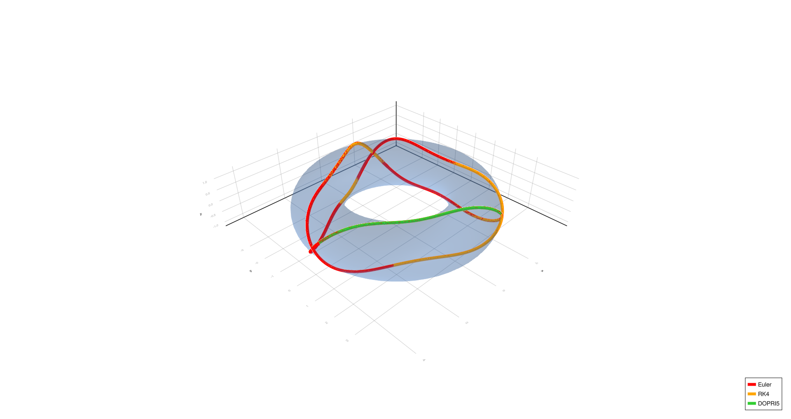

# Geodesics Using the Method of Christoffel Symbols

Project for the *Mathematical Modelling* course, Faculty of Computer and
Information Science, University of Ljubljana (2025).

Geodesics on a plane, a sphere and a torus are derived analytically from the
Christoffel symbols of each surface's parametrization, rewritten as a
first-order ODE system, solved numerically and rendered in 3D. Three
integrators are compared across step sizes.

<p align="center">
  
</p>

## Method

For a parametrization $\vec f(u_1, u_2)$ with metric tensor $G$, the geodesics
satisfy

$$
\ddot u^k + \sum_{i=1}^{2}\sum_{j=1}^{2} \Gamma^k_{ij}\,\dot u^i \dot u^j = 0,
\qquad k = 1, 2,
$$

where the Christoffel symbols are computed from the surface itself:

$$
\Gamma^k_{ij} = \sum_{\ell=1}^{2}
\left(\frac{\partial^2 \vec f}{\partial u_i \partial u_j}\cdot
\frac{\partial \vec f}{\partial u_\ell}\right) g^{\ell k}.
$$

With the state $y = [u,\ \dot u,\ v,\ \dot v]$, each surface becomes a system of
four first-order equations. The report derives the plane, sphere and torus
cases step by step.

## Numerical methods

| Method | Order | Step size | Implementation |
| --- | --- | --- | --- |
| Euler | 1 | fixed $h$ | written from scratch |
| Runge–Kutta 4 | 4 | fixed $h$ | written from scratch |
| Dormand–Prince 5 (DOPRI5) | 5 | adaptive | `DP5()` from DifferentialEquations.jl, tolerances $10^{-9}$ (sphere) and $10^{-12}$ (torus) |

## Experiments

- **Sphere:** equatorial, meridional and diagonal geodesics.
- **Torus** ($R = 3$, $r = 1$): inner and outer equator, four turns, complex
  spiral, six turns, triangle.
- Fixed-step methods run at $h = 1.0$, $0.01$ and $0.0001$.

## Results

- Geodesics along a symmetry line (the sphere's equator and meridian, the
  torus's inner and outer equator) are reproduced by all three methods at every
  step size.
- On the other paths, Euler deviates strongly at $h = 1.0$, slightly at
  $h = 0.01$, and only matches the others at $h = 0.0001$. RK4 and DOPRI5 agree
  at every step size.
- The trade-off: Euler is the simplest to implement but needs very small steps,
  while RK4 and DOPRI5 are already accurate at $h = 0.01$.

## Repository

```
geodesics.jl   solvers, geodesic ODE systems and 3D plotting (GLMakie)
report/        LaTeX source, compiled PDF and figures
```

## Running

Requires Julia and the following packages:

```julia
using Pkg
Pkg.add(["DifferentialEquations", "GeometryBasics", "GLMakie", "Makie", "ColorTypes"])
```

Then run `julia geodesics.jl`. It opens the sphere and torus figures for the
initial conditions set in `main()`; change `Y0`, `tspan` and `h` there to
reproduce the other cases from the report.
